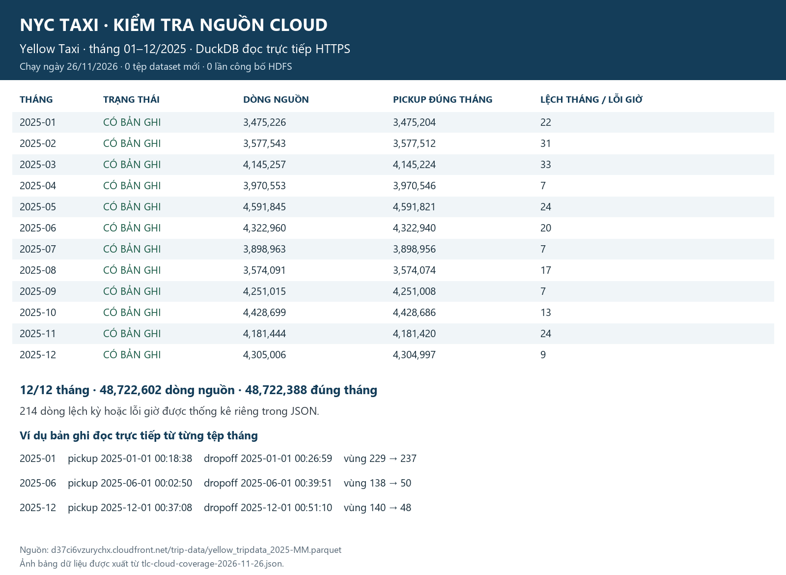

# Báo cáo ingestion và test standalone cho Minh

Ngày kiểm tra **26/11/2026**. Nhánh bàn giao **`demo/ingestion`**. Bản kiểm tra dùng bộ **Yellow Taxi năm 2025**, cùng năm đã sử dụng trong các lần demo trước.

## Kết quả kiểm tra nguồn cloud

Đã đọc trực tiếp đủ **12/12 tệp tháng 01–12/2025** trên cloud TLC qua HTTPS. Kết quả quét timestamp xác nhận mỗi tệp đều có bản ghi thuộc đúng năm/tháng cần kiểm tra. Tổng cộng **48.722.602 dòng nguồn**, trong đó **48.722.388 dòng có pickup đúng tháng ghi trong tên tệp**. Có **214 dòng lệch tháng hoặc lỗi thời gian** được thống kê riêng.

Lượt chạy kéo dài **25,391 giây** trên Windows, DuckDB 1.5.6, giới hạn bộ nhớ DuckDB 512 MB và 2 luồng. DuckDB đọc các phần Parquet cần thiết qua HTTP vào bộ nhớ để nhóm theo timestamp và lấy mẫu. Lượt kiểm tra ghi báo cáo JSON/Markdown, với **0 tệp dataset mới và 0 lần công bố HDFS**. Các tệp extension DuckDB có thể được cache để chạy HTTPS.

Ảnh dưới đây được xuất từ JSON của lượt kiểm tra. JSON giữ số liệu từng tháng, phân bố năm/tháng thực tế của timestamp và hai bản ghi mẫu có pickup, dropoff, vùng đón/trả cho mỗi tháng.



| Tháng nguồn | Tổng dòng | Pickup đúng tháng | Lệch tháng / lỗi giờ | Pickup đầu trong tháng | Pickup cuối trong tháng |
| --- | ---: | ---: | ---: | --- | --- |
| 2025-01 | 3,475,226 | 3,475,204 | 22 | 2025-01-01 00:00:00 | 2025-01-31 23:59:59 |
| 2025-02 | 3,577,543 | 3,577,512 | 31 | 2025-02-01 00:00:00 | 2025-02-28 23:59:59 |
| 2025-03 | 4,145,257 | 4,145,224 | 33 | 2025-03-01 00:00:00 | 2025-03-31 23:59:59 |
| 2025-04 | 3,970,553 | 3,970,546 | 7 | 2025-04-01 00:00:00 | 2025-04-30 23:59:59 |
| 2025-05 | 4,591,845 | 4,591,821 | 24 | 2025-05-01 00:00:00 | 2025-05-31 23:59:58 |
| 2025-06 | 4,322,960 | 4,322,940 | 20 | 2025-06-01 00:00:00 | 2025-06-30 23:59:59 |
| 2025-07 | 3,898,963 | 3,898,956 | 7 | 2025-07-01 00:00:00 | 2025-07-31 23:59:59 |
| 2025-08 | 3,574,091 | 3,574,074 | 17 | 2025-08-01 00:00:01 | 2025-08-31 23:59:59 |
| 2025-09 | 4,251,015 | 4,251,008 | 7 | 2025-09-01 00:00:00 | 2025-09-30 23:59:59 |
| 2025-10 | 4,428,699 | 4,428,686 | 13 | 2025-10-01 00:00:00 | 2025-10-31 23:59:59 |
| 2025-11 | 4,181,444 | 4,181,420 | 24 | 2025-11-01 00:00:00 | 2025-11-30 23:59:59 |
| 2025-12 | 4,305,006 | 4,304,997 | 9 | 2025-12-01 00:00:00 | 2025-12-31 23:59:59 |

Phạm vi xác nhận là có bản ghi đúng từng kỳ và đã quét phân bố timestamp của toàn bộ tệp nguồn được chọn. Khi công bố dữ liệu history/replay, coverage theo khoảng, vùng, lỗi nguồn và chính sách DST tiếp tục được kiểm tra theo hợp đồng ingestion.

Bằng chứng chi tiết ở [JSON nguồn cloud](evidence/tlc-cloud-coverage-2026-11-26.json). Danh sách tệp công khai được đối chiếu tại [TLC Trip Record Data](https://www.nyc.gov/site/tlc/about/tlc-trip-record-data.page). Mỗi URL đọc có dạng `https://d37ci6vzurychx.cloudfront.net/trip-data/yellow_tripdata_2025-MM.parquet`.

## Dữ liệu hiện nằm ở đâu

| Đối tượng | Vị trí đã xác minh | Trạng thái |
| --- | --- | --- |
| Tệp nguồn 12 tháng năm 2025 | Cloud TLC, truy cập qua CloudFront HTTPS | Đã quét trực tiếp ngày 26/11/2026 |
| Cache gốc tháng 01/2025 | `output/tlc-source-cache/yellow_tripdata_2025-01.parquet` | 59.158.238 bytes, 3.475.226 dòng |
| Cache gốc tháng 02/2025 | `output/tlc-source-cache/yellow_tripdata_2025-02.parquet` | 60.343.086 bytes, 3.577.543 dòng |
| HDFS demo trước đây | Cụm Docker trên GitHub Actions, 1 NameNode và 2 DataNode | Đã chạy nghiệm thu ngày 10/11; cụm đã dừng sau lượt CI |
| HDFS cho nhóm sử dụng lâu dài | Repo hiện cung cấp cấu hình cụm Docker và URI `hdfs://namenode:8020` | Cần địa chỉ cụm được nhóm triển khai để công bố dữ liệu và nhận URI manifest thực tế |

Hai cache trên máy là dữ liệu có sẵn từ các lần kiểm tra trước. Lượt kiểm tra mới đã đọc lại chúng và xác nhận có bản ghi tháng 01–02/2025. Phân bố chi tiết nằm trong [JSON kiểm kê local](evidence/tlc-local-coverage-2026-11-26.json). Các phép thử kết nối tới cổng HDFS/Kafka localhost trong lượt này không kết nối thành công.

Nguồn cloud TLC hiện là nơi đọc dữ liệu công khai. Việc lưu dữ liệu dẫn xuất lên HDFS thuộc bước `publish_datasets` và cần cụm đích hoạt động. Bằng chứng HDFS cũ dùng một triệu dòng tổng hợp để kiểm tra replication/retry/failover, có mô tả trong [báo cáo HDFS](hdfs-validation.md) và [workflow nghiệm thu](https://github.com/tnbminh020506/nyc-taxi-pipeline/actions/runs/42779664661).

## Minh chạy test standalone

Cài một lần từ thư mục repo, dùng Python 3.10 trở lên.

```powershell
python -m venv .venv
.venv/Scripts/python.exe -m pip install -r requirements-dev.txt
```

Kiểm tra trực tiếp cloud năm 2025, đủ 12 tháng.

```powershell
.venv/Scripts/python.exe tests/standalone_ingestion.py
```

Test độc lập này chỉ cần Internet. Kết quả mặc định là `output/standalone-ingestion/source-coverage.json` và `source-coverage.md`. Lệnh trả mã 0 khi tất cả tháng có bản ghi đúng kỳ, mã 1 khi có tháng lỗi hoặc thiếu bản ghi đúng kỳ. Khi một tháng lỗi, báo cáo vẫn giữ kết quả của các tháng còn lại.

Kiểm tra riêng một số tháng hoặc năm khác bằng các tham số sau.

```powershell
.venv/Scripts/python.exe tests/standalone_ingestion.py --years 2025 --months 1 2 12
# Đọc cache đã có trên máy
.venv/Scripts/python.exe tests/standalone_ingestion.py --years 2025 --months 1 2 --local-directory output/tlc-source-cache
# Kiểm tra logic ingestion v2 độc lập với nguồn ngoài
.venv/Scripts/python.exe tests/standalone_ingestion.py --offline
# Kiểm tra toàn bộ cả v1 và v2
.venv/Scripts/python.exe -m pytest -q -m "not kafka"
```

`--offline` chạy các ca lấy trang API, công bố/đọc lại qua WebHDFS HTTP mô phỏng, ID replay, tọa độ nằm trong polygon, pickup/dropoff ack, lỗi archive, snapshot và kiểm tra sai năm/tháng. Dữ liệu fixture tạm chỉ phục vụ kiểm thử. Các test dùng Kafka double và repository giả lập để Minh chạy được trước khi ghép phần pipeline/warehouse.

## Trạng thái phần Chính

| Đầu việc | Mã triển khai và kết quả | Điểm bàn giao |
| --- | --- | --- |
| 1.1 Nguồn và vùng | API phân trang v2/v3, retry có giới hạn, kiểm tra count/ID; lookup CSV và GeoJSON | Định danh dòng nguồn, pickup/dropoff và phiên bản nguồn |
| 1.2 HDFS và manifest | Upload tạm, xác minh hash/replica, công bố manifest bất biến sau cùng | URI HDFS và manifest v2 cho Mạnh/Bảo |
| 1.3 Replay | `ride_requested` có ID ổn định, giữ điểm đến/thời lượng, sinh tọa độ trong polygon, clock chung | Schema v2 cho router của Mạnh |
| 1.4 Kafka và pickup publisher | Chờ broker ack, lấy pickup từ outbox đã commit, retry cùng event ID | `PickupRepository` của Bảo |
| Simulator trả khách | Phát theo due của từng request sau pickup ack, giữ giờ hoàn tất theo lịch | `DropoffRepository` của Bảo |
| Archive | Lưu nguyên payload/key/header/offset, commit offset sau receipt HDFS, journal/admission và snapshot | `ArchiveRepository` của Bảo và admission ledger của Mạnh |

Chi tiết CLI, DTO và factory repository ở [bàn giao Ingestion v2](ingestion-v2.md). HDFS/Kafka/PostgreSQL toàn tuyến v2 cần ghép repository và admission ledger thực tế từ các phần của Bảo/Mạnh.

Các cấu hình manifest-v1 như `configs/fixture.yaml` và `configs/demo.example.yaml` tiếp tục chạy theo hợp đồng cũ. Cấu hình v2 là `configs/ingestion.example.yaml`, với URI manifest và scope bắt buộc khi replay. Mã mới v2 và compatibility v1 cùng được kiểm tra sau khi hợp nhất.

## Nhánh và kiểm thử bàn giao

Phần v2 ở commit `bb3f0f2` đã được hợp nhất vào `demo/ingestion` cùng các thay đổi standalone, báo cáo và ảnh bằng chứng của lượt này. Các commit và lịch sử kiểm thử cũ vẫn tra được trên nhánh. Lệnh `git pull --ff-only origin demo/ingestion` lấy bản bàn giao sau khi chọn nhánh `demo/ingestion`.

Kết quả cục bộ ngày 26/11/2026.

| Phép kiểm tra | Kết quả |
| --- | --- |
| Standalone offline | 14/14 ca đạt |
| Toàn bộ unit/HTTP/contract v1 và v2 | 71 ca đạt; 2 ca Kafka cần broker được tách khỏi lượt local |
| Quét nguồn cloud năm 2025 | 12/12 tháng có bản ghi đúng kỳ, 48.722.602 dòng tổng |
| Quét hai cache local | 2/2 tháng có bản ghi đúng kỳ, 7.052.769 dòng tổng |

Workflow [Ingestion checks](https://github.com/tnbminh020506/nyc-taxi-pipeline/actions/workflows/ingestion.yml) chạy khi push nhánh `demo/ingestion`, bao gồm Windows/Ubuntu, Kafka và HDFS thật trên CI. Các job HDFS/Kafka hiện dùng kịch bản v1 đã có; các hợp đồng v2 được kiểm tra bằng bộ standalone.

Lượt [CI 45830709274](https://github.com/tnbminh020506/nyc-taxi-pipeline/actions/runs/45830709274) nghiệm thu commit `6505ab7` đã **success**. Cả bốn job Windows, Ubuntu, Kafka roundtrip và HDFS roundtrip đều đạt. HDFS chạy kịch bản một triệu dòng tổng hợp và fault-test. Job tải/materialize TLC khối lượng lớn được skip theo cấu hình của push; bằng chứng nguồn cloud 12 tháng là lượt quét trực tiếp được lưu trong JSON ngày 26/11 ở trên.
