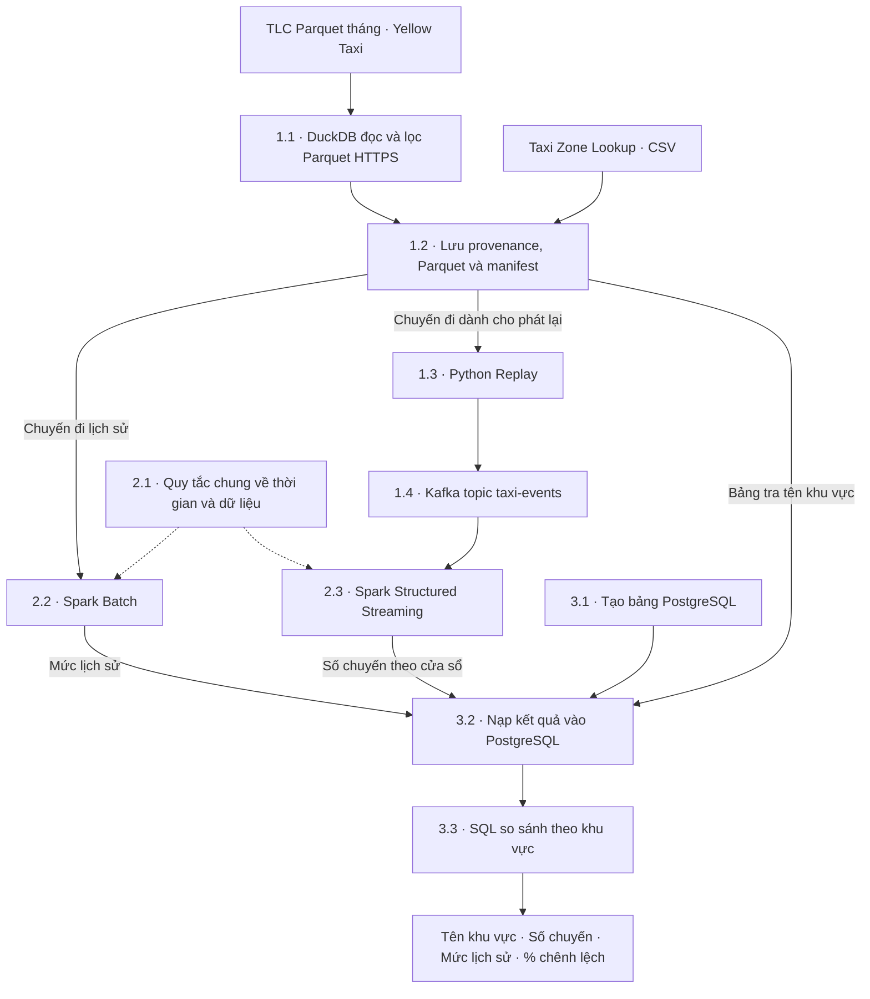

# Hướng dẫn triển khai pipeline taxi NYC

> Cập nhật 10/11/2026 theo nhóm trưởng: bước 1.1 của Chính chuyển sang DuckDB đọc Parquet trực tiếp từ TLC vì API nguồn đang lỗi. JSON API cũ được giữ làm fixture/lịch sử kiểm thử; không còn yêu cầu gọi v2/v3 cho luồng mặc định.

> Yêu cầu demo đã chốt: history/replay khoảng **3:2 theo số bản ghi hợp lệ** (60%/40%), history trước replay, không chia ngẫu nhiên. Bộ demo hiện tại dùng hai thứ Hai 06/01 và 20/01/2025, cùng 08:00–10:00 giờ New York: 8.461/5.651 dòng, đạt 59,96%/40,04%. Ưu tiên nguồn đã cache, không gọi lặp TLC khi kiểm thử hoặc phát lại. [Prompt giao agent làm ban đêm](../overnight-ingestion.md).

## Tổng quan luồng quy trình

Demo trả lời câu hỏi **“Khu vực nào ghi nhận nhiều chuyến đón khách hơn mức lịch sử trong cùng khung 15 phút?”**

Hệ thống lấy dữ liệu Yellow Taxi từ **file Parquet tháng của TLC qua DuckDB**. Tầng **ingestion** lọc hai khoảng thời gian đã chọn, tạo Parquet lịch sử/phát lại và lưu provenance nguồn để đối chiếu.

Tầng **processing** dùng Spark Batch để tính số chuyến đón khách trung bình theo khu vực, thứ trong tuần và khung 15 phút. Với tập phát lại, Python tạo các sự kiện đón khách và gửi dần qua Kafka. Spark Structured Streaming đọc các sự kiện đó để đếm số chuyến theo khu vực trong từng cửa sổ 15 phút.

Tầng **data warehouse** lưu kết quả tổng hợp của hai nhánh vào các bảng PostgreSQL và dùng Taxi Zone Lookup để hiện tên khu vực. Người xem chọn một phiên phát lại và một cửa sổ để truy vấn số chuyến quan sát, mức lịch sử và phần trăm chênh lệch.

| Phần | Phụ trách | Kết quả cần bàn giao |
| --- | --- | --- |
| 1. Data Ingestion | Chính | Provenance TLC, Parquet cho hai tập, manifest và sự kiện phát lại qua Kafka |
| 2. Data Processing | Mạnh | Mức lịch sử từ batch và số chuyến từ stream |
| 3. Data Warehouse | Bảo | Các bảng PostgreSQL, cách nạp và truy vấn demo |
| 4. Kiểm tra toàn tuyến | Nhóm trưởng cùng ba thành viên | Bộ mẫu chung, kết quả đối chiếu và hướng dẫn chạy |

## 1. Data Ingestion — Chính

**Mục tiêu giai đoạn.** Đưa dữ liệu TLC vào workspace bằng DuckDB để hai nhánh xử lý dùng được. Chính lấy đúng các khoảng nhóm chốt, ghi thông tin nguồn để đối chiếu, tạo Parquet và manifest. Với tập replay, Chính phát sự kiện pickup qua Kafka cho Mạnh đọc dần.

### 1.1. Dùng DuckDB lấy trực tiếp Parquet TLC

- **Mục đích.** Thay việc gọi API đang lỗi bằng đọc file tháng từ nguồn TLC chính thức.
- **Đầu vào.** URL HTTPS Parquet Yellow Taxi theo tháng, trường `tpep_pickup_datetime` và `PULocationID`; hai khoảng không giao nhau cho `history` và `replay`, do nhóm trưởng chốt. Không cần app token.
- **Việc cần làm.** DuckDB đọc các tháng giao với kỳ, lọc pickup theo `[bắt đầu,kết thúc)`, chọn cột cần thiết và COPY trực tiếp ra Parquet với giới hạn bộ nhớ/đĩa tạm. Ghi số file, số dòng và lỗi; chỉ hoàn tất khi đọc được mọi file cần thiết. Kiểm thử cả dữ liệu lớn thực và chạy lặp lại.
- **Đầu ra.** Hai tập Parquet, danh sách file nguồn/bộ lọc, số liệu đối chiếu và trạng thái để bàn giao bước 1.2.

[Nguồn TLC chính thức](https://www.nyc.gov/site/tlc/about/tlc-trip-record-data.page) · [DuckDB đọc Parquet](https://duckdb.org/docs/stable/data/parquet/overview).

### 1.2. Lưu provenance, Parquet và lập manifest

- **Mục đích.** Tạo đầu vào cục bộ đọc được cho batch/replay và lưu dấu vết nguồn để kiểm tra.
- **Đầu vào.** Kết quả DuckDB từ 1.1 và CSV Taxi Zone Lookup.
- **Việc cần làm.** Lưu `source.json` mô tả URL/đường dẫn tháng, SQL, phạm vi, phiên bản và checksum đầu ra; lưu CSV lookup nguyên bản. Không yêu cầu JSON chuyến gốc vì nguồn mới là Parquet. Manifest giữ schema đã thống nhất, ghi vai trò, nguồn, khoảng thời gian, `raw_path`, `parquet_path` và trạng thái. Chỉ công bố `ready` khi đọc hết các file tháng đã chọn và ghi xong Parquet.
- **Đầu ra.** `raw_path` của chuyến đi trỏ đến thư mục provenance, không giả định đã lưu toàn bộ file tháng gốc. `parquet_path` đưa history sang 2.2 và replay sang 1.3. Bảo nhận CSV qua `zone_lookup`. Giới hạn độ phủ của file tháng, quy tắc DST và cách giữ nguồn đầy đủ được ghi trong [hợp đồng ingestion](../ingestion.md).

### 1.3. Đọc lại chuyến đi và tạo sự kiện đón khách

- **Mục đích.** Mô phỏng một nguồn gửi sự kiện theo thời gian để Spark có dữ liệu đến dần.
- **Đầu vào.** File và phạm vi `replay` từ bước 1.2, mã phiên phát lại và cấu hình tốc độ phát.
- **Việc cần làm.** Viết chương trình Python đọc các dòng theo thời điểm đón khách và gửi dần sang Kafka. Mỗi dòng trong bộ mẫu có một `event_id` ổn định khi gửi lại. Chỉ đưa vào sự kiện các thông tin đã biết lúc đón khách.
- **Đầu ra.** Các sự kiện JSON gửi đến bước 1.4. Mỗi sự kiện có `replay_id` (mã phiên), `event_id` (mã sự kiện), `pickup_at` (thời điểm đón), `pickup_zone_id` (mã vùng đón) và `source_file` (file Parquet replay để đối chiếu qua manifest).

### 1.4. Đưa sự kiện vào Kafka topic `taxi-events`

- **Mục đích.** Đệm sự kiện để chương trình phát lại và Spark có thể chạy theo tốc độ riêng.
- **Đầu vào.** Các sự kiện JSON do chương trình Python ở bước 1.3 gửi đến.
- **Việc cần làm.** Cấu hình Kafka và topic `taxi-events`. Phát một nhóm sự kiện mẫu và kiểm tra bên đọc thấy được đúng trường và đúng mã sự kiện.
- **Đầu ra.** Topic có dữ liệu để Spark đọc ở bước 2.3. Kafka giữ các sự kiện đã nhận, còn phép đếm chuyến được thực hiện ở Spark.

## 2. Data Processing — Mạnh

**Mục tiêu giai đoạn.** Chuyển các bản ghi chuyến đi thành hai bộ số liệu có thể so sánh. Mạnh dùng Spark Batch để tính mức lịch sử và Spark Structured Streaming để đếm số chuyến vừa phát lại. Hai nhánh cùng dùng giờ New York, cùng quy tắc chọn chuyến hợp lệ và cùng cửa sổ 15 phút để Bảo ghép đúng các kết quả tương ứng.

### 2.1. Thống nhất quy tắc thời gian và dữ liệu

- **Mục đích.** Để số chuyến trong hai nhánh được tính theo cùng cách.
- **Đầu vào.** Schema Parquet, JSON sự kiện mẫu và khoảng thời gian từ Chính. Đối chiếu ánh xạ từ các cột TLC `tpep_pickup_datetime` và `PULocationID` (giá trị raw xuất thành `pulocationid`) sang thời điểm đón và mã vùng chuẩn.
- **Việc cần làm.** Chuẩn hóa thời điểm đón và mã khu vực. Dùng giờ New York (`America/New_York`) để xác định thứ và khung 15 phút. Dùng timestamp có múi giờ khi gửi hoặc lưu. Quy ước cửa sổ gồm mốc bắt đầu và loại mốc kết thúc, nên chuyến đúng 08:15 thuộc khung 08:15–08:30. Ghi nhận và loại khỏi phép đếm bản ghi thiếu thời điểm đón hoặc có mã vùng sai định dạng.
- **Đầu ra.** Bộ quy tắc và cách ghi số liệu kiểm tra chất lượng dùng chung cho 2.2 và 2.3. Nhịp đọc dữ liệu của Spark được cấu hình riêng với độ dài cửa sổ 15 phút.

### 2.2. Tính mức lịch sử bằng Spark Batch

- **Mục đích.** Trả lời “Khu vực này thường có bao nhiêu chuyến vào thứ và khung giờ đang xét?”
- **Đầu vào.** File `history` đã sẵn sàng, phạm vi trong manifest và quy tắc từ 2.1.
- **Việc cần làm.** Đếm chuyến theo từng khu vực và từng cửa sổ lịch sử. Sau đó lấy trung bình các cửa sổ có cùng thứ và khung giờ, ví dụ các thứ Hai từ 08:00 đến 08:15. Chỉ dùng các cửa sổ có độ phủ đã xác nhận, tính cả cửa sổ thực sự có 0 chuyến.
- **Đầu ra.** Một dòng cho mỗi khu vực, thứ và khung giờ, gồm `pickup_zone_id`, `iso_weekday`, `slot_15m`, `baseline_trip_count` và `reference_windows` (số cửa sổ dùng để tính). Bàn giao kèm phạm vi lịch sử cho bước 3.2.

### 2.3. Đếm chuyến phát lại bằng Spark Structured Streaming

- **Mục đích.** Cập nhật số chuyến của từng khu vực trong mỗi cửa sổ khi có sự kiện mới.
- **Đầu vào.** Topic `taxi-events` ở bước 1.4 và quy tắc từ 2.1.
- **Việc cần làm.** Đọc JSON, kiểm tra trường bắt buộc và loại lần gửi lại theo cặp `replay_id` và `event_id`. Phân cửa sổ theo giờ đón khách ghi trong sự kiện. Lưu checkpoint theo phiên để hỗ trợ đọc tiếp khi khởi động lại. Ghi số bản ghi hợp lệ, lỗi và sự kiện gửi trùng được phát hiện.
- **Đầu ra.** Số chuyến lũy kế của từng cửa sổ trong phiên, gồm `replay_id`, `pickup_zone_id`, `window_start`, `window_end` và `trip_count`. Ví dụ, khi cửa sổ tăng từ 2 lên 3 chuyến, gửi tổng mới là 3 cho bước 3.2.

## 3. Data Warehouse và truy vấn — Bảo

**Mục tiêu giai đoạn.** Biến kết quả của hai nhánh thành câu trả lời có thể xem bằng SQL. Bảo dựng ba bảng, nạp tên vùng, mức lịch sử và số đếm từ stream. Khi người dùng chọn một phiên và một cửa sổ, truy vấn ghép đúng vùng và khung giờ để hiển thị số chuyến, mức lịch sử và phần trăm chênh lệch.

### 3.1. Tạo các bảng PostgreSQL

- **Mục đích.** Xác định nơi lưu bảng tra cứu và hai loại kết quả xử lý.
- **Đầu vào.** Cấu trúc Zone Lookup ở 1.2 và các cột đầu ra đã thống nhất với Mạnh ở 2.2 và 2.3.
- **Việc cần làm.** Tạo bảng khu vực theo mã vùng, bảng mức lịch sử theo vùng–thứ–khung giờ và bảng số chuyến phát lại theo phiên–vùng–mốc đầu cửa sổ. Dùng bộ khóa tương ứng để mỗi kết quả chỉ có một dòng.
- **Đầu ra.** SQL khởi tạo ba bảng và mô tả các cột, kiểu dữ liệu, khóa để Mạnh và Bảo thống nhất cách nạp.

### 3.2. Nạp dữ liệu và cập nhật kết quả

- **Mục đích.** Đưa đầu ra của hai nhánh vào kho để SQL có thể truy vấn.
- **Đầu vào.** Các bảng ở 3.1, Zone Lookup ở 1.2, mức lịch sử ở 2.2 và số đếm cửa sổ ở 2.3.
- **Việc cần làm.** Nạp lookup và mức lịch sử. Khi nhận tổng mới từ stream, cập nhật dòng theo khóa phiên–vùng–cửa sổ. Kiểm tra nạp lại cùng một đầu ra để xác nhận số dòng và số chuyến giữ nguyên.
- **Đầu ra.** Ba bảng có dữ liệu trong PostgreSQL, sẵn sàng cho bước 3.3.

### 3.3. Truy vấn kết quả demo

- **Mục đích.** Cho biết số chuyến trong cửa sổ vừa phát lại chênh lệch thế nào so với mức lịch sử tương ứng.
- **Đầu vào.** Mã phiên replay, cửa sổ muốn xem và ba bảng từ 3.2.
- **Việc cần làm.** Ghép theo mã vùng, thứ và khung giờ New York. Tính tỷ lệ theo công thức `(số chuyến phát lại − mức lịch sử) / mức lịch sử × 100%`. Nếu thiếu mức lịch sử hoặc mức lịch sử bằng 0, vẫn hiện số chuyến và ghi lý do để trống tỷ lệ. Nếu lookup thiếu tên, vẫn hiện mã vùng.
- **Đầu ra.** Câu SQL có thể chạy lại và bảng kết quả gồm mã/tên vùng, số chuyến phát lại, mức lịch sử, số cửa sổ tham chiếu và tỷ lệ chênh lệch.

## 4. Kiểm tra toàn tuyến — Cả nhóm

### 4.1. Chạy trên bộ mẫu có kết quả biết trước

- **Mục đích.** Kiểm tra từng điểm bàn giao và kết quả cuối trước khi chạy trên mẫu TLC thật.
- **Đầu vào.** Các trang JSON mẫu theo schema API và CSV lookup có một vùng A. Hai cửa sổ lịch sử 08:00–08:15 vào hai thứ Hai trước kỳ replay có lần lượt 1 và 3 chuyến. Vào thứ Hai của kỳ replay có các chuyến lúc 08:01, 08:05, 08:14 và 08:15. Ca gửi trùng phát lại một sự kiện với cùng mã.
- **Việc cần làm.** Chuẩn bị Kafka và các bảng PostgreSQL. Nhập JSON mẫu và tạo Parquet, chạy batch, khởi động stream rồi phát sự kiện. Cuối cùng chạy SQL với mã phiên và cửa sổ muốn xem.
- **Đầu ra.** Mức lịch sử là **2 chuyến** trên hai cửa sổ. Stream ghi **3 chuyến** trong khung 08:00–08:15 và **1 chuyến** trong khung 08:15–08:30. SQL cho vùng A ở khung đầu trả **3 chuyến**, mức lịch sử **2**, chênh lệch **+50%**.

### 4.2. Chạy lại với dữ liệu TLC qua DuckDB và bàn giao

- **Mục đích.** Xác nhận hệ thống có thể nhận dữ liệu nguồn đã chọn và tạo bảng phân tích.
- **Đầu vào.** Pipeline đã qua 4.1, cấu hình DuckDB/TLC, lookup và phạm vi lịch sử/replay do nhóm trưởng chốt.
- **Việc cần làm.** Chạy toàn tuyến với dữ liệu đã chốt. Mỗi người ghi lệnh chạy, đường dẫn mã, đầu vào, đầu ra thực tế và phần còn vướng. Ba thành viên có thể làm song song từ bộ mẫu 4.1 sau khi thống nhất schema file, JSON và bảng kết quả.
- **Đầu ra.** Một lượt chạy có thể lặp lại, ghi rõ file tháng/nguồn TLC, bộ lọc SQL, kỳ lịch sử, kỳ replay và kết quả SQL. Ghi riêng kết quả fixture, ingestion dữ liệu lớn và nghiệm thu toàn tuyến.

Tài liệu tham khảo cho dữ liệu nguồn, bộ mẫu và báo cáo bàn giao. [NYC TLC Trip Record Data](https://www.nyc.gov/site/tlc/about/tlc-trip-record-data.page) · [Đặc tả bộ mẫu](../../data/fixtures/README.md) · [Báo cáo MVP](../mvp-report.md).
