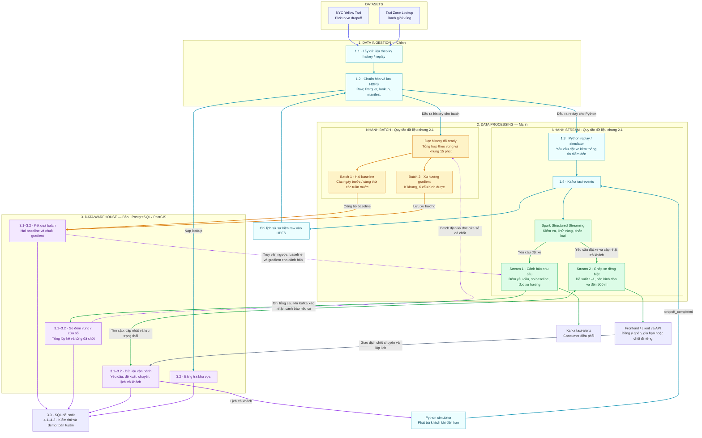
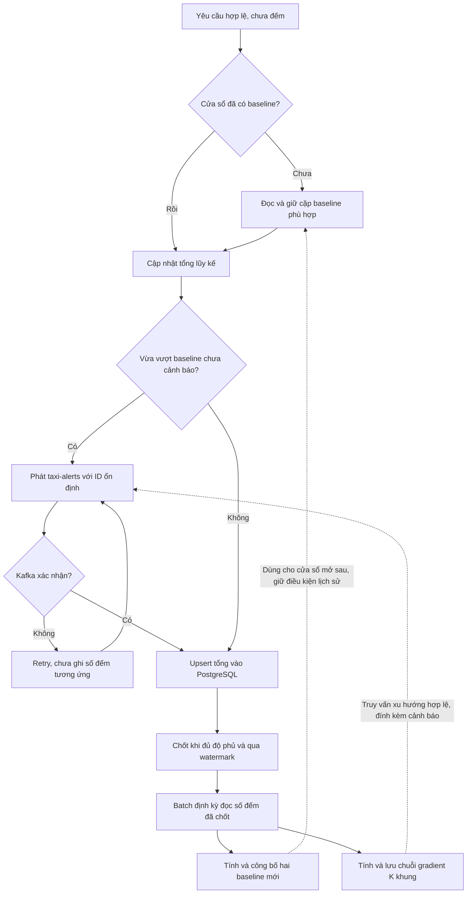
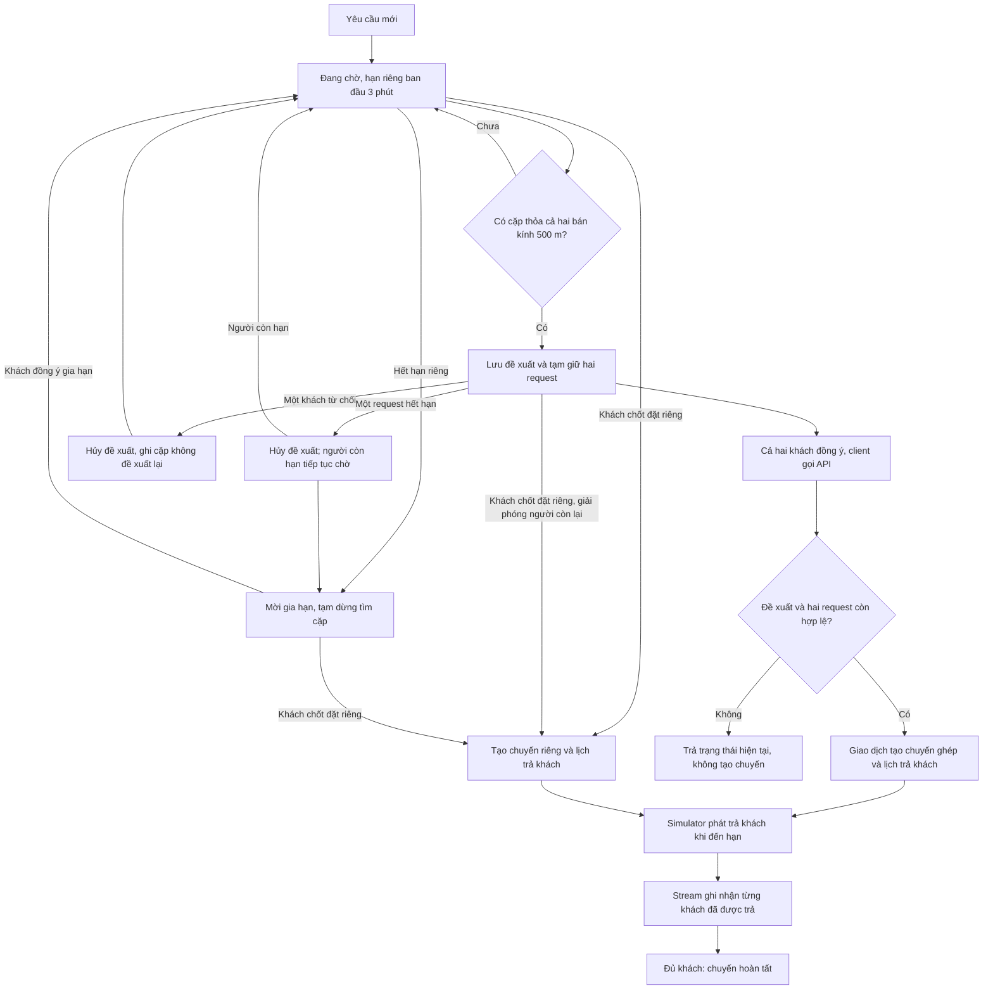

# Hướng dẫn triển khai pipeline taxi NYC

## Phạm vi và các quyết định đã chốt

Tài liệu này là thiết kế và hướng dẫn giao việc cập nhật ngày 17/11/2026, không phải xác nhận các chức năng đã chạy hoàn chỉnh. Các khung Python, SQL, cấu hình và bộ mẫu trong repo cần được triển khai hoặc cập nhật theo hợp đồng dưới đây; tên bảng mới là đề xuất triển khai.

Hệ thống có **hai xử lý batch** và **hai xử lý stream**:

| Xử lý | Mục tiêu | Kết quả |
| --- | --- | --- |
| Batch 1 — baseline | Tính nhu cầu lịch sử theo vùng và khung 15 phút với hai cách chọn ngày | Hai baseline phục vụ cảnh báo điểm nóng |
| Batch 2 — xu hướng | Tính gradient giữa các khung liên tiếp đã hoàn tất | Chuỗi gradient phục vụ ngữ cảnh cảnh báo; K cấu hình được, mặc định 4 |
| Stream 1 — cảnh báo | Đếm yêu cầu, so với hai baseline và đọc gradient | Cảnh báo ngay khi vừa vượt một hoặc cả hai baseline |
| Stream 2 — ghép | Tìm hai yêu cầu phù hợp, đề xuất và xử lý vòng đời chuyến | Đề xuất ghép 1–1, xác nhận, đi riêng và hoàn tất phục vụ |

Đơn vị đo nhu cầu là **yêu cầu đặt xe**, không phải số xe hay số chuyến đã hoàn tất. Hai yêu cầu ghép thành một chuyến vẫn đóng góp hai yêu cầu vào nhu cầu. Thời tiết/ngày lễ là mở rộng; quản lý vehicle_id, đội xe và số xe rảnh tạm ngoài phạm vi. Không tăng biến số xe rảnh khi nhận sự kiện trả khách trong phiên bản này.

## Tổng quan luồng dữ liệu

**Màu đường nối:** Theo nhóm công việc tại đầu phát: datasets tím xanh, ingestion/replay xanh lam, batch cam, stream xanh lá và PostgreSQL tím. Đường từ client/API dùng xám; nét đứt giữ ý nghĩa truy vấn hoặc đọc lại dữ liệu.

**Cách đọc sơ đồ:** Đi từ datasets xuống ingestion, rồi tách hai đầu ra history cho batch và replay cho stream. Hai batch công bố kết quả vào PostgreSQL; đường nét đứt kéo kết quả ngược lên nhánh cảnh báo để truy vấn, đồng thời đưa số đếm đã chốt trở lại batch tính tiếp. Nhánh ghép truy vấn dữ liệu vận hành riêng, không dùng baseline/gradient để quyết định ghép.

Các nhãn 1.1–1.4, 2.1 và 3.1–4.2 bám theo bản đồ nhiệm vụ trong README; phần processing được mở rộng thành hai batch và hai stream theo thiết kế mới. Replay/simulator thuộc trách nhiệm Chính, dù đặt cạnh đầu vào stream để dễ đọc luồng. README và [bản đồ giao việc](README.md) đã đồng bộ theo thiết kế đích; các file nhiệm vụ chi tiết nằm trong ingestion/, pipeline/ và warehouse/.

**Cả hai batch phục vụ stream cảnh báo:** Baseline quyết định có vượt ngưỡng; gradient cung cấp ngữ cảnh nhu cầu tăng/giảm trong thông điệp và đối soát. Chưa đặt thêm điều kiện phát cảnh báo độc lập từ gradient. Stream đọc chuỗi gradient đã công bố gần nhất, chỉ gồm các khung kết thúc không muộn hơn thời điểm dữ liệu đang xử lý; nếu thiếu thì vẫn cảnh báo bằng baseline và ghi rõ chưa có xu hướng. Ghi kèm phiên bản và thời điểm kết thúc chuỗi gradient, không coi xu hướng batch là giá trị tức thời.

Hai nhánh stream là hai trách nhiệm xử lý; không bắt buộc hai tiến trình riêng. API có thể được gọi bằng client demo khi chưa có frontend. Bộ ghi HDFS phải nhận cả sự kiện đặt xe và trả khách; HDFS không tự nhận sự kiện chỉ vì Kafka đã nhận chúng.

| Phần | Phụ trách | Bàn giao |
| --- | --- | --- |
| Ingestion và mô phỏng | Chính | Nguồn, manifest, replay, tọa độ ổn định, đồng hồ mô phỏng, phát sự kiện trả khách và lưu sự kiện vào HDFS |
| Processing | Mạnh | Hai batch, hai luồng stream, quy tắc kiểm tra, khử trùng và hợp đồng với API |
| Kho dữ liệu | Bảo | PostgreSQL/PostGIS, truy vấn bán kính, giao dịch ghép, công bố baseline, lưu lịch phát và đối soát |
| Tích hợp | Cả nhóm | API/client demo, phân công người triển khai API, dữ liệu kiểm thử và bằng chứng chạy toàn tuyến |

## 1. Data Ingestion — Chính

### 1.1. Nhập dữ liệu NYC và công bố HDFS

- Chọn dataset và hai kỳ không giao nhau: `history` kết thúc trước `replay`. Giữ dataset Yellow Taxi 2025 `irx2-vgm4` là đề xuất hiện có; xác minh tên trường thực tế trước khi cấu hình truy vấn.
- Lấy thời điểm pickup/dropoff và mã vùng pickup/dropoff. Không bỏ thông tin điểm đến của dòng nguồn. Lưu JSON nguyên bản, Parquet dẫn xuất, Taxi Zone Lookup và manifest trên HDFS.
- Manifest ghi nguồn, vai trò, khoảng `[range_start, range_end)`, `raw_path`, `parquet_path`, số dòng, độ phủ và trạng thái. Chỉ công bố `ready` khi tải đủ phạm vi và đầu ra hoàn chỉnh.
- Batch ban đầu đọc history; replay chỉ đọc đúng phạm vi replay. Một dòng chuyến lịch sử được dùng như một yêu cầu đặt xe mô phỏng. Đây là cách mô phỏng nhu cầu từ dữ liệu chuyến đã xảy ra, không phải nguồn yêu cầu đặt xe thực tế của NYC.
- Nếu chỉ có zone ID, cần dữ liệu ranh giới vùng ngoài CSV tra tên để sinh tọa độ nằm trong đúng vùng. Sinh riêng điểm đón và điểm đến; dùng seed theo định danh dòng nguồn để giữ tọa độ ổn định khi replay lại. Ghi rõ đây là tọa độ mô phỏng.

### 1.2. Hợp đồng sự kiện

Dùng topic `taxi-events` với `event_type` để phân loại. Giữ `replay_id` làm mã phiên cho cả replay và simulator. Những tên trường dưới đây là hợp đồng đích, thay cho schema pickup đơn giản trước đây.

| Nhóm | Trường cần có và ý nghĩa |
| --- | --- |
| Chung | `schema_version`, `event_type`, `event_id`, `replay_id`, `event_at`, `source_kind`, `source_file`/định danh dòng nguồn nếu có |
| `ride_requested` | `request_id`, `requested_at`, `pickup_zone_id`, `dropoff_zone_id`, tọa độ đón/đến, thời điểm pickup/dropoff gốc hoặc thời lượng nguồn |
| `dropoff_completed` | `trip_id`, `request_id`, `completed_at`, vùng/tọa độ trả khách và định danh lịch phát |

`event_id` giữ nguyên khi gửi lại; `request_id` nhận diện yêu cầu, không dùng thay cho mã sự kiện. Với replay, `requested_at` lấy từ pickup nguồn; giữ dropoff làm dữ liệu điểm đến và mô phỏng thời lượng. `event_at` của sự kiện hoàn tất là thời điểm hoàn tất mô phỏng, không phải thời điểm đặt. Timestamp dùng ISO 8601 có offset hoặc UTC.

Không để việc thiếu thông tin ghép làm mất một yêu cầu có thời gian/vùng đón hợp lệ khỏi phép đếm nhu cầu: ghi lý do không đủ điều kiện ghép riêng. Dữ liệu tọa độ/thời lượng lỗi phải được ghi nhận và cách xử lý được cấu hình, không tự tạo chuyến hoàn tất với thời lượng âm.

### 1.3. Tạo và replay sự kiện trả khách

1. Python phát yêu cầu với thông tin pickup và dropoff của chính dòng NYC. Simulator mới tạo dữ liệu tương đương.
2. Khi khách chốt đi riêng hoặc hai khách đồng ý ghép, API tạo chuyến và lịch trả khách bền vững trong cùng giao dịch. Không lập một chuyến hoàn tất cho yêu cầu còn chờ gia hạn.
3. Dùng thời lượng nguồn `dropoff_time - pickup_time`. Mốc trả khách mô phỏng được tính từ lúc chuyến bắt đầu phục vụ, để không trả khách trước khi họ chốt chuyến.
4. Simulator đọc lịch, đến hạn thì phát `dropoff_completed` vào Kafka. Giữ cùng event_id khi retry; việc restart không được làm mất lịch hoặc tạo hoàn tất trùng về nghiệp vụ.
5. Với ghép 1–1, phát sự kiện trả khách riêng cho từng request; chuyến chỉ hoàn tất sau cả hai. Bản demo dùng thời lượng nguồn của từng request tính từ lúc bắt đầu chuyến chung; đây là mô phỏng, chưa tính lộ trình hay thời gian đi vòng thực tế.

Một yêu cầu được phục vụ thành công có sự kiện đặt và sự kiện trả khách; yêu cầu hủy không có hoàn tất. Hai yêu cầu ghép có hai sự kiện đặt và hai sự kiện trả khách, nhưng chỉ một trip.

Mọi thành phần dùng cùng đồng hồ mô phỏng và tốc độ replay, bao gồm thời gian chờ, gia hạn và lịch trả khách. Khi có người tương tác, ưu tiên tốc độ 1×. Bộ lập lịch phải tiếp tục tiến đồng hồ khi không có yêu cầu mới; không chờ sự kiện kế tiếp để phát hoàn tất hoặc thông báo hết hạn.

## 2. Data Processing — Mạnh

### 2.1. Quy tắc dùng chung

- Dùng `America/New_York` để xác định ngày, thứ và slot 15 phút. Timestamp lưu/trao đổi có múi giờ. Cửa sổ `[bắt đầu, kết thúc)`: 08:15 thuộc 08:15–08:30.
- Đếm yêu cầu theo `requested_at`; không đếm sự kiện trả khách vào nhu cầu. Khử trùng theo phiên và event_id, đồng thời bảo đảm một request chỉ đóng góp một lần.
- Tách nhịp trigger stream khỏi cửa sổ nghiệp vụ 15 phút và lịch batch 15 phút.
- Chốt cửa sổ sau watermark và xác nhận đủ độ phủ. Với replay hữu hạn, tín hiệu kết thúc chỉ chốt sau khi toàn bộ dữ liệu trong phạm vi đã được xử lý. Khung đủ độ phủ nhưng không có yêu cầu là 0; khung thiếu dữ liệu không phải 0.
- Bản demo ghi log/cách ly sự kiện đến sau khi đã chốt; không âm thầm sửa số liệu lịch sử. Nếu bổ sung cơ chế hiệu chỉnh sau này, phải tính lại đầu ra phụ thuộc và công bố phiên bản mới.
- Tách các phiên mô phỏng; replay lại không tự cộng một tập lịch sử lần thứ hai. Kỳ history và số đếm replay dùng để huấn luyện không được chồng lặp.

### 2.2. Batch 1 — Hai baseline cho điểm nóng

**Đầu vào:** Khởi tạo số đếm lịch sử từ Parquet history trên HDFS; các lần định kỳ đọc số đếm vùng–cửa sổ đã chốt trong PostgreSQL. Dùng cùng quy tắc tính nhu cầu của stream.

| Baseline | Các cửa sổ lịch sử được chọn |
| --- | --- |
| `all_days` | Cùng vùng, cùng khung 15 phút ở các ngày trước, không phân biệt thứ |
| `same_weekday` | Cùng vùng, cùng khung 15 phút, cùng thứ ở các tuần trước |

> **Baseline = Tổng số yêu cầu trong các khung lịch sử được chọn ÷ Số khung được chọn**

Phạm vi lịch sử là cấu hình. Chỉ lấy ngày trước ngày áp dụng, không dùng dữ liệu tương lai hoặc ngày đang xét. Tính cả cửa sổ có 0 yêu cầu nhưng đủ độ phủ. Không có mẫu thì baseline chưa xác định, không gán 0. Trung bình được giữ dạng thập phân.

**Đầu ra:** Hai baseline theo vùng/slot và thứ phù hợp; kèm loại baseline, số cửa sổ tham chiếu, phạm vi lịch sử, thời điểm cắt dữ liệu, ngày áp dụng và phiên bản công bố. Batch ghi qua staging và công bố nguyên bộ trong giao dịch để stream không đọc hai mức thuộc hai lần chạy khác nhau.

Chạy định kỳ 15 phút; kết quả có thể không đổi nếu chưa có thêm ngày lịch sử đủ điều kiện. Khi replay về thời điểm cũ, chọn phiên bản và phạm vi lịch sử phù hợp với thời gian mô phỏng; không lấy baseline chứa dữ liệu tương lai. Nếu không có phiên bản phù hợp, ghi nhận thiếu baseline hoặc chạy batch khởi tạo cho phạm vi đó.

### 2.3. Batch 2 — Xu hướng bằng gradient

**Đầu vào:** Số yêu cầu của **K khung 15 phút liên tiếp đã hoàn tất và đủ dữ liệu**, theo từng vùng. `trend_window_count` là hyperparameter cấu hình được, mặc định **4**, tối thiểu **2**; không viết cứng số 4 trong xử lý.

> **Gradient = (Số yêu cầu khung sau − Số yêu cầu khung trước) ÷ 15 phút**

| Khung liên tiếp | Số yêu cầu | Gradient so với khung trước |
| --- | ---: | ---: |
| 1 | 20 | — |
| 2 | 35 | +1 yêu cầu/phút |
| 3 | 65 | +2 yêu cầu/phút |
| 4 | 50 | −1 yêu cầu/phút |

Nhu cầu tăng, tăng nhanh hơn, rồi chuyển sang giảm. Gradient dương là tăng; âm là giảm; bằng 0 là số đếm không đổi. Độ lớn thể hiện mức thay đổi; đổi dấu là dấu hiệu chuyển chiều. Đây là tốc độ thay đổi số đếm giữa các khung, không phải số yêu cầu phát sinh mỗi phút.

**Đầu ra:** K số đếm và K−1 gradient có mốc cửa sổ, vùng, phiên/phạm vi dữ liệu, K và phiên bản batch. Không rút gọn thành chỉ một phép tính đầu–cuối hay hồi quy. Không nối qua khung thiếu dữ liệu như thể hai khung liền nhau; chưa đủ K khung thì đánh dấu chưa đủ dữ liệu. Batch chạy mỗi 15 phút, tính trên snapshot các khung đã chốt.

Điểm nóng và xu hướng độc lập: vùng có thể vượt baseline nhưng đang giảm, hoặc đang tăng nhưng chưa vượt baseline.

### 2.4. Stream 1 — Đếm và cảnh báo ngay khi vượt baseline

1. Khi mở một cửa sổ vùng trong phiên, lấy cặp baseline phù hợp từ PostgreSQL. Lưu phiên bản và cả hai giá trị vào trạng thái bền vững để giữ nguyên suốt cửa sổ, kể cả khi batch công bố mức mới hoặc stream restart.
2. Với mỗi lần cập nhật yêu cầu hợp lệ, xét riêng từng baseline: **số đếm trước ≤ baseline < số đếm sau**. Vượt bất kỳ mức nào thì vùng được đánh dấu nóng. Nếu baseline bằng 0, yêu cầu đầu tiên kích hoạt; thiếu một baseline thì vẫn xét mức còn lại.
3. Phát lên `taxi-alerts`. Nếu cùng lần xử lý vượt cả hai, gộp một thông điệp chứa hai điều kiện. Mỗi điều kiện có ID ổn định theo `(replay_id, zone, window_start, baseline_type)` để consumer khử trùng; chỉ một cảnh báo nghiệp vụ cho mỗi loại baseline trong vùng–cửa sổ.
4. Chờ Kafka xác nhận cảnh báo rồi mới ghi tổng số yêu cầu tương ứng vào PostgreSQL. Nếu phát lỗi, retry với cùng ID và số đếm đã xác định. Micro-batch không có cảnh báo mới có thể ghi ngay. Quy tắc này áp dụng cho bảng số đếm; không cấm nhánh ghép lưu bản ghi yêu cầu độc lập.
5. SQL gán tổng lũy kế theo khóa thay vì cộng lại khi retry. Chốt cửa sổ chỉ đánh dấu tổng cuối và độ phủ cho batch đọc; **không tính lại baseline trong giao dịch chốt**.

Cảnh báo mang phiên, vùng, cửa sổ, số đếm tại lần vượt, danh sách baseline đã vượt, giá trị, số mẫu và phiên bản baseline; kèm chuỗi gradient phù hợp gần nhất, K, phiên bản và mốc kết thúc dữ liệu xu hướng nếu có. Gradient bổ sung ngữ cảnh, không thay điều kiện vượt baseline. Ví dụ hai mức 20 và 25: yêu cầu thứ 21 vượt mức đầu; thứ 26 vượt mức sau. Không phát lại mỗi khi số đếm tiếp tục tăng. Độ trễ phụ thuộc trigger và thời gian xử lý, không phải chờ đủ 15 phút.

### 2.5. Stream 2 — Đề xuất ghép 1–1

**Điều kiện:** Hai request khác nhau, cùng phiên, còn đủ điều kiện tìm cặp; khoảng cách giữa hai điểm đón **≤ 500 m** và giữa hai điểm đến **≤ 500 m**. Zone dùng cho phân tích và sinh tọa độ nguồn, không còn là điều kiện hoặc ưu tiên ghép. Bản đầu ghép đúng hai yêu cầu; chưa xét sức chứa và số hành khách.

Dùng PostgreSQL/PostGIS để tìm ứng viên từ bản ghi đang chờ. Truy vấn bán kính dùng tọa độ địa lý và đơn vị mét; đây là khoảng cách địa lý, không phải chiều dài đường xe chạy. Đề xuất thứ tự xử lý ổn định: xét người chờ lâu nhất, chọn ứng viên có điểm đón gần nhất, sau đó điểm đến gần nhất, thời điểm đặt và request_id để phá hòa. Không tuyên bố đây là tối ưu lộ trình.

- Lưu đề xuất và tạm giữ hai request để không cùng lúc đề xuất A với nhiều người. Khóa/kiểm tra lại cả hai request khi tạo đề xuất.
- Hai khách đồng ý rồi frontend/client mới gọi API xác nhận ghép. API kiểm tra bằng chứng đồng ý của cả hai, trạng thái và hạn hiện tại; không chỉ tin một cờ `accepted` không gắn với hai request.
- API xác nhận hợp lệ thì tạo trip, liên kết hai request và lịch trả khách trong cùng giao dịch. Gọi lại cùng đề xuất phải trả cùng kết quả, không tạo trip thứ hai.
- Một khách từ chối cặp thì hủy đề xuất, cho hai người tìm đối tác khác trong thời gian còn lại và lưu cặp bị từ chối theo hai request_id không phụ thuộc thứ tự. Không đề xuất lại cặp đó trong phiên đặt xe hiện tại.
- Mỗi request chờ ban đầu **3 phút** theo đồng hồ mô phỏng, tính độc lập từ lúc đặt; có đề xuất không reset thời hạn.
- Hết hạn thì mời gia hạn, **không tự tạo chuyến riêng**. Đề xuất đang chờ liên quan hết hiệu lực; người hết hạn tạm dừng tìm cặp, người còn hạn tiếp tục tìm. Khi gia hạn, có thể đề xuất lại A–B nếu cặp chưa chủ động từ chối nhau.
- Gia hạn không giới hạn số lần, cho đến khi khách hủy ghép và chốt đặt riêng. Chưa phản hồi lời mời gia hạn thì giữ trạng thái chờ phản hồi, không coi im lặng là đồng ý hoặc tự đặt riêng. Thời lượng mỗi lần gia hạn là tham số cần điền trước demo, chưa được chốt thành 3 phút.
- Khách chốt đi riêng thì giải phóng mọi đề xuất còn hiệu lực, tạo trip riêng và lịch trả khách. Đây là chốt dịch vụ mô phỏng, không phân công xe thật.

Timeout, từ chối, gia hạn và xác nhận API có thể xảy ra gần nhau: mọi chuyển trạng thái phải kiểm tra phiên bản/trạng thái trong giao dịch để chỉ một kết quả có hiệu lực. Sơ đồ thể hiện các sự kiện độc lập, không yêu cầu vòng lặp bận liên tục.

## 3. PostgreSQL, HDFS và hợp đồng lưu trữ — Bảo

### 3.1. Các nhóm dữ liệu

| Nhóm/bảng đích đề xuất | Khóa và nội dung chính | Cách tăng dữ liệu |
| --- | --- | --- |
| `taxi_zones` | Mã vùng, tên, dữ liệu tham chiếu cần thiết | Theo số vùng |
| `demand_windows` | Phạm vi dữ liệu/phiên, vùng, window_start; tổng yêu cầu, window_end, độ phủ, trạng thái chốt, snapshot hai baseline | Theo vùng × cửa sổ × phạm vi được giữ; thêm request trong cùng khóa chỉ tăng tổng |
| `historical_baseline` | Phiên bản/phạm vi, loại baseline, vùng, slot và thứ khi áp dụng; số mẫu, giá trị, kỳ tham chiếu, cutoff | Bản hiện hành theo các nhóm cố định; phiên bản phục vụ đối soát có thời hạn giữ |
| `demand_gradients` | Phạm vi, vùng, cặp cửa sổ và phiên bản batch; hai số đếm, gradient, K | Theo cửa sổ được giữ |
| `ride_requests` | Phiên và request_id; điểm đón/đến, thời gian, trạng thái, hạn riêng, dữ liệu nguồn | Theo request còn hoạt động và thời gian lưu ngắn sau kết thúc |
| `match_proposals`, `rejected_pairs` | Mã đề xuất, hai request, trạng thái, xác nhận; cặp chủ động từ chối | Phục vụ ghép và chống đề xuất lại |
| `trips`, `trip_requests` | Trip và các request thành viên, trạng thái hoàn tất từng người | Một trip ghép liên kết hai request |
| `scheduled_events` | Event_id duy nhất, trip/request, thời điểm phát, payload, trạng thái gửi | Lịch hoàn tất chưa phát/chưa đối soát |
| Sổ khử trùng và xác nhận lưu trữ | Event_id/request_id, trạng thái xử lý và xác nhận HDFS | Giữ đủ lâu để retry không đếm hoặc tạo lại chuyến |

Các bảng `replay_pickup_counts` và `baseline_history_windows` cũ cần được ánh xạ/hợp nhất khi triển khai `demand_windows`; không để hai bản sao cùng đóng góp vào batch. Quy tắc cũ cập nhật baseline ngay trong SQL chốt cửa sổ được thay bằng batch tính lại.

### 3.2. Batch cập nhật trong khi stream tiếp tục ghi

1. Nạp lookup; khởi tạo số đếm history từ HDFS, ghi theo khóa ổn định. Nạp lại không cộng thêm cùng dữ liệu.
2. Chạy batch công bố baseline ban đầu trước khi bật demo cảnh báo.
3. Stream liên tục ghi tổng và trạng thái chốt. Batch định kỳ lấy snapshot nhất quán các cửa sổ đã chốt tại cutoff của lần chạy; dữ liệu đến sau dành cho lần tiếp theo.
4. Batch tính hai baseline và gradient theo phạm vi dữ liệu đã chọn. Không tự trộn nhiều phiên replay hoặc trộn dữ liệu simulator vào baseline nguồn thật ngoài cấu hình demo.
5. Công bố baseline nguyên bộ và phiên bản; stream chỉ dùng phiên bản mới khi mở cửa sổ mới. Kết quả gradient lưu cùng mốc dữ liệu và K để đối soát.

### 3.3. Hoàn tất, lưu HDFS và dọn bản ghi vận hành

HDFS giữ JSON nguồn NYC, Parquet dẫn xuất, manifest và sự kiện ứng dụng gốc có nguồn/loại rõ ràng. Sự kiện nhận trùng có thể tồn tại trong raw; các bước tính toán phải khử trùng bằng event_id. Lưu thêm lịch sử chuyển trạng thái cần thiết để truy vết xác nhận, gia hạn và từ chối trước khi dọn bản ghi vận hành.

Khi một khách đã được trả, stream cập nhật request; chỉ khi cả hai khách của chuyến ghép đã được trả mới hoàn tất trip. Không đếm lại nhu cầu tại bước này. Có thể tổng hợp số khách được trả theo vùng/thời gian riêng; không gọi đó là số xe rảnh và không trộn với số chuyến hoàn tất.

Chỉ dọn chi tiết request/trip/đề xuất đã kết thúc khi:

- Số liệu cần thiết đã được ghi bền vững và không phụ thuộc việc giữ bản ghi vận hành.
- Sự kiện và dữ liệu truy vết cần thiết đã được xác nhận lưu HDFS.
- Lịch phát đã hoàn tất và có cơ chế ngăn sự kiện retry tạo lại bản ghi/chuyến hoặc tăng tổng lần nữa.

Xóa theo quan hệ dữ liệu, không xóa request đang chờ/gia hạn hoặc request còn liên quan chuyến chưa hoàn tất. Thời hạn lưu chi tiết, lịch sử tổng hợp và sổ khử trùng là cấu hình. Với gia hạn không giới hạn, số request đang hoạt động không được giả định luôn cố định.

### 3.4. Truy vấn demo

- Điểm nóng: số yêu cầu, hai baseline thực tế đã dùng, số mẫu, phiên bản, điều kiện đã vượt và thời điểm cảnh báo.
- Xu hướng: K khung và K−1 gradient; không dùng một số đầu–cuối thay thế chuỗi.
- Ghép: hai tọa độ đón/đến, hai khoảng cách, hạn từng người, trạng thái đề xuất và xác nhận API.
- Vòng đời: request → proposal → trip → lịch trả khách → sự kiện hoàn tất → xác nhận HDFS → đủ điều kiện dọn.
- Tỷ lệ vượt baseline có thể dùng `(số yêu cầu - baseline) / baseline × 100%`; baseline 0 hoặc thiếu thì để trống tỷ lệ và ghi lý do, vẫn xử lý cảnh báo theo quy tắc.

## 4. Kiểm tra và tích hợp — Cả nhóm

### 4.1. Bộ mẫu nghiệm thu cần cập nhật

| Ca | Kết quả cần kiểm chứng |
| --- | --- |
| Hai baseline | History đủ độ phủ được thiết kế để ra 20 và 25; đếm đến 20 chưa vượt, 21 vượt mức đầu, 26 vượt mức sau; một micro-batch vượt cả hai có đủ hai điều kiện |
| Ngưỡng 0/thiếu | 0 kích hoạt ở request đầu; thiếu mẫu không giả thành 0; một mức thiếu không vô hiệu mức còn lại |
| Thứ tự cảnh báo | Kafka xác nhận trước khi bắt đầu upsert số đếm tương ứng; lỗi Kafka chưa ghi tổng vượt ngưỡng; consumer khử trùng retry |
| Batch cập nhật | Chốt cửa sổ chưa đổi baseline; batch tiếp theo mới công bố. Cửa sổ đã mở giữ snapshot cũ, cửa sổ mới đọc phiên bản phù hợp |
| Gradient | 20, 35, 65, 50 cho +1, +2, −1; thay K từ 4 sang 3 cho hai gradient cuối; khung thiếu không bị xem là 0 hoặc nối tắt |
| Thời gian và trùng | Mốc đúng 08:15 sang cửa sổ mới; gửi lại request không tăng tổng; gửi lại hoàn tất không tăng nhu cầu hoặc tạo hoàn tất nghiệp vụ lần hai |
| Khoảng cách | Cả hai khoảng cách ≤500 m mới đủ điều kiện; một khoảng cách >500 m thì loại; khác zone nhưng đủ gần vẫn ghép được |
| Xác nhận | Chỉ một khách đồng ý chưa tạo trip; cả hai đồng ý và API hợp lệ tạo đúng một trip dù gọi lại; API trễ bị từ chối khi đề xuất hết hiệu lực |
| Gia hạn độc lập | A hết hạn, B còn hạn: đề xuất hết hiệu lực, A được mời gia hạn, B tiếp tục tìm; không tự đặt riêng; A gia hạn có thể gặp lại B |
| Từ chối | A–B chủ động từ chối thì không đề xuất lại với thứ tự đảo B–A; vẫn ghép được với người khác |
| Hoàn tất | Dropoff lấy từ cùng dòng NYC, thời lượng dịch theo lúc bắt đầu chuyến; chuyến ghép chưa hoàn tất khi mới trả một người |
| Lưu trữ và restart | Restart không mất lịch trả khách; không dọn khi HDFS chưa xác nhận; sự kiện gửi lại sau dọn không hồi sinh chuyến hoặc đếm lại |

Các ca trên là tiêu chí cần triển khai vào bộ mẫu và kiểm thử; không mặc định `tests/test_pipeline_contract.py` hiện tại đã bao phủ chúng.

### 4.2. Thứ tự triển khai

1. Chính, Mạnh, Bảo chốt schema nguồn/sự kiện, phạm vi history/replay và cấu hình; bổ sung dữ liệu vùng nếu cần sinh tọa độ.
2. Dựng HDFS, Kafka, PostgreSQL/PostGIS; triển khai bảng và giao dịch đích. Chuẩn bị bộ ghi HDFS, API/client và simulator có lịch phát bền vững.
3. Nhập history, chạy batch ban đầu; kiểm chứng hai baseline và số mẫu.
4. Khởi động hai luồng stream, bộ ghi HDFS và simulator; phát request, xác nhận ghép hoặc chốt đi riêng, quan sát trả khách.
5. Chạy batch định kỳ song song stream; kiểm tra gradient, snapshot baseline và việc chỉ dùng lịch sử hợp lệ.
6. Chạy bộ mẫu có kết quả biết trước rồi chạy dữ liệu NYC. Ghi riêng kết quả mẫu và dữ liệu nguồn; lưu lệnh, cấu hình, phiên bản, log và phần chưa hoàn thành.

### 4.3. Cấu hình cần có trước khi chạy

| Thông số | Quy tắc |
| --- | --- |
| Cửa sổ nhu cầu và chu kỳ batch | 15 phút; trigger stream cấu hình riêng |
| `trend_window_count` | Hyperparameter K, mặc định 4, tối thiểu 2 |
| Phạm vi baseline | Cấu hình số ngày/tuần hoặc khoảng lịch sử; cùng phạm vi nhất quán cho lần công bố |
| Bán kính đón và đến | Mỗi điều kiện tối đa 500 m |
| Chờ ban đầu | 3 phút cho từng request |
| Thời lượng gia hạn | Cần điền trước demo; không giới hạn số lần gia hạn, không tự chốt đi riêng khi hết hạn |
| Đồng hồ và replay | Chung cho sự kiện, timeout và simulator; 1× khi tương tác thủ công |
| Watermark và dữ liệu muộn | Cấu hình độ trễ; bản đầu log/cách ly sau chốt |
| Lưu trữ và khử trùng | Cấu hình thời hạn và xác nhận HDFS trước dọn; bao phủ khoảng retry được hỗ trợ |

### 4.4. Khu vực triển khai và hướng dẫn chi tiết

Xem [bản đồ 19 công việc](README.md) và [hợp đồng chung](contracts.md). `src/nyc_taxi_pipeline/` chia thành `ingestion/`, `pipeline/`, `warehouse/` và `shared/`. SQL chuyển vào `warehouse/sql/`; Python/SQL chỉ giữ comment TODO và đường dẫn guide. Scripts chỉ là điểm chạy dự kiến, chưa có CLI thực thi.

Cấu hình và môi trường vẫn cần triển khai theo mục 4.3. Bộ mẫu, tests và báo cáo thuộc 4.1–4.2 giữ nguyên để cả nhóm tự cập nhật; không coi hợp đồng cũ trong các file đó là thiết kế mới. Việc tổ chức module không xác nhận chức năng đã chạy.

Tham chiếu nguồn và tài liệu trong repo: [NYC TLC Trip Record Data](https://www.nyc.gov/site/tlc/about/tlc-trip-record-data.page), [dataset Yellow Taxi 2025](https://data.cityofnewyork.us/Transportation/2025-Yellow-Taxi-Trip-Data/irx2-vgm4/about_data), [bộ mẫu hiện có](../../data/fixtures/README.md), [báo cáo MVP](../mvp-report.md).
