# Thiết kế và giao việc pipeline taxi NYC

Cập nhật 18/11/2026. Đây là đặc tả triển khai; Python/SQL hiện là khung TODO, chưa phải hệ thống đã chạy. Đọc [bản đồ công việc](README.md) và [hợp đồng dữ liệu](contracts.md). Mục 4.1–4.2 do cả nhóm tự thực hiện; lần cập nhật này không triển khai test/demo toàn tuyến.

## 1. Luồng tổng thể

Có **ba batch**, chạy mỗi 15 phút, và **ba stream**. Request đo nhu cầu; trip đo lượt điều phối/đón; trả khách đếm theo request. Không gọi số trip là số xe phân biệt, không quản lý đội xe/vehicle_id trong phạm vi này.

```mermaid
%%{init: {"theme": "base", "themeVariables": {"textColor": "#ffffff", "primaryTextColor": "#ffffff", "secondaryTextColor": "#ffffff", "tertiaryTextColor": "#ffffff", "nodeTextColor": "#ffffff", "titleColor": "#ffffff", "edgeLabelBackground": "transparent", "background": "transparent"}, "themeCSS": ".nodeLabel, .nodeLabel p, .nodeLabel span, .edgeLabel, .edgeLabel p, .edgeLabel span, .cluster-label, .cluster-label p, .cluster-label span { color: #ffffff !important; } text, .label text, .cluster-label text, .edgeLabel text { fill: #ffffff !important; } rect.labelBkg { fill: transparent !important; } .labelBkg { background: transparent !important; background-color: transparent !important; } .edgeLabel, .edgeLabel p, .edgeLabel span, .nodeLabel, .nodeLabel p, .nodeLabel span, .cluster-label, .cluster-label p, .cluster-label span { background: transparent !important; background-color: transparent !important; }"}}%%
flowchart LR
    subgraph SOURCES["NGUỒN DỮ LIỆU"]
        direction LR
        NYC["NYC Yellow Taxi<br/>Trip lịch sử đầy đủ"]
        ZONES["Taxi Zone Lookup<br/>Ranh giới vùng"]
    end

    subgraph INGESTION["1. DATA INGESTION"]
        direction TB
        FETCH["1.1 · Thu thập dữ liệu<br/>Theo kỳ history / replay"]
        STORE["1.2 · Chuẩn hóa và công bố HDFS<br/>Raw · Parquet · lookup · manifest ready"]
        REPLAY["1.3 · Replay / simulator<br/>Phát yêu cầu đặt xe"]
        KAFKA["1.4 · Kafka taxi-events<br/>Đặt xe · đón khách · trả khách"]
        PICKUP["Phát sự kiện đón khách<br/>Một pickup cho mỗi trip đã chốt"]
        DROPOFF["Simulator trả khách<br/>Phát theo lịch từng request"]
        ARCHIVE["Archive consumer<br/>Lưu sự kiện và journal vào HDFS"]
        EVENTS["HDFS lịch sử sự kiện<br/>Snapshot · coverage · receipt"]
        JACK((" "))
    end

    subgraph PROCESSING["2. DATA PROCESSING"]
        direction TB
        subgraph BATCH["NHÁNH BATCH · Chu kỳ 15 phút"]
            direction TB
            INPUT["Đọc snapshot đầu vào<br/>Cùng phạm vi và cutoff"]
            B1["Batch 1 · Baseline nhu cầu<br/>Các ngày trước / cùng thứ tuần trước"]
            B2["Batch 2 · Gradient trong ngày<br/>K khung liên tiếp đã chốt"]
            B3["Batch 3 · Lượt đón trung bình trong ngày<br/>Chỉ tính khung có trip đón"]
            SUMMARY["Tổng hợp cuối sau ba batch<br/>Số đếm 15 phút · kết quả · phiên bản"]
        end
        subgraph STREAM["NHÁNH STREAM · Nhịp xử lý 15 giây"]
            direction TB
            ROUTE["Chuẩn hóa · khử trùng · phân loại<br/>Theo event time"]
            S1["Stream 1 · Cảnh báo baseline<br/>Giữ mức tham chiếu của cửa sổ"]
            S2["Stream 2 · Lưu lượng và spike<br/>Gom theo phút · kiểm tra tăng đột ngột 15 giây"]
            LIVE["Serving view · 60 phút gần nhất<br/>Số trip đón theo zone"]
            S3["Stream 3 · Ghép và điều phối<br/>Cache ứng viên · quản lý vòng đời"]
            JCOUNTS((" "))
        end
    end

    subgraph WAREHOUSE["3. DATA WAREHOUSE · PostgreSQL / PostGIS"]
        direction TB
        LOOKUP["Bảng tra khu vực<br/>Tên vùng · hình học"]
        BATCHVIEW["Batch view và kết quả thống kê<br/>Hai baseline · gradient · trung bình ngày<br/>Số đếm 15 phút · phiên bản công bố"]
        STREAMVIEW["Stream view · Cửa sổ 15 phút<br/>Số đếm · baseline snapshot · trạng thái chốt"]
        MINUTES["Lịch sử số đếm theo phút<br/>Upsert cùng phiên–zone–phút<br/>Giữ toàn bộ trong PostgreSQL"]
        OPS["Dữ liệu và giao dịch điều phối<br/>Request · cặp ghép · trip · thành viên<br/>Pickup outbox · lịch trả · journal"]
        RECEIPTS["Xác nhận archive và khử trùng<br/>Điều kiện dọn chi tiết vận hành"]
        RETENTION["Retention vận hành<br/>Kiểm tra điều kiện trước khi dọn"]
    end

    USER["API / client<br/>Đồng ý đã có · gia hạn · chốt riêng"]
    ALERT["Kafka taxi-alerts<br/>Cảnh báo baseline / tăng đột ngột"]
    DASH["Dashboard quản trị<br/>Lưu lượng · xu hướng · lịch sử"]
    AUDIT["Đối soát batch–stream<br/>Cùng phiên · zone · cửa sổ · cutoff"]

    NYC -->|"Trip lịch sử"| FETCH
    ZONES -->|"Lookup và ranh giới vùng"| FETCH
    FETCH --> STORE
    STORE -->|"replay ready"| REPLAY
    REPLAY -->|"ride_requested"| KAFKA
    PICKUP -->|"pickup_completed"| KAFKA
    DROPOFF -->|"dropoff_completed"| KAFKA
    STORE -->|"history ready: khởi tạo lịch sử nhu cầu"| INPUT
    EVENTS -->|"Snapshot sự kiện thực tế: batch đối chứng"| INPUT
    STORE -->|"lookup / ranh giới ready"| LOOKUP
    KAFKA -->|"Consumer group xử lý"| ROUTE
    KAFKA -->|"Consumer group archive độc lập"| ARCHIVE
    ARCHIVE -->|"Ghi bền vững sự kiện và journal"| EVENTS
    INPUT --> B1
    INPUT --> B2
    INPUT --> B3
    B1 -->|"Kết quả / trạng thái Batch 1"| SUMMARY
    B2 -->|"Kết quả / trạng thái Batch 2"| SUMMARY
    B3 -->|"Kết quả / trạng thái Batch 3"| SUMMARY
    INPUT -->|"Đầu vào đếm độc lập với stream"| SUMMARY
    SUMMARY -->|"Chờ đủ ba batch rồi công bố nguyên tử"| BATCHVIEW
    ROUTE -->|"Request hợp lệ để đếm nhu cầu"| S1
    ROUTE -->|"Request / pickup / dropoff để thống kê"| S2
    ROUTE -->|"Request để ghép; pickup / dropoff cập nhật vòng đời"| S3
    S1 -->|"Vượt baseline; ID cảnh báo ổn định"| ALERT
    S2 -->|"Spike: R mới > k × R trước và > M"| ALERT
    S1 -->|"Request count + version sau ack cảnh báo"| JCOUNTS
    S2 -->|"Pickup / dropoff / completed trip + version riêng"| JCOUNTS
    JCOUNTS -->|"Ghi cột riêng của từng writer"| STREAMVIEW
    S2 -->|"Upsert tổng phút + version; retry không cộng trùng"| MINUTES
    S2 -->|"Cập nhật cửa sổ 60 phút"| LIVE
    S3 -->|"Ghi request / ghép / trip / outbox / lịch; cập nhật vòng đời"| OPS
    USER -->|"Quyết định người dùng / bằng chứng đồng ý"| S3
    S3 -->|"Phản hồi trạng thái / version / trip"| USER
    OPS -.->|"Kết quả tra ứng viên / consent / trạng thái / hạn"| S3
    BATCHVIEW -.->|"Baseline / gradient đọc từ kho"| S1
    STREAMVIEW -.->|"Snapshot / tiến độ phục hồi"| S1
    MINUTES -.->|"Lịch sử dựng lại view theo as_of"| LIVE
    LOOKUP -.->|"Danh mục zone được tra cứu"| S2
    OPS -.->|"Outbox đã commit được đọc / claim"| PICKUP
    OPS -.->|"Lịch được đọc / claim sau pickup ack"| DROPOFF
    KAFKA -->|"Broker ack pickup"| PICKUP
    KAFKA -->|"Broker ack dropoff"| DROPOFF
    PICKUP -->|"Ack pickup theo event_id"| JACK
    DROPOFF -->|"Ack dropoff theo event_id"| JACK
    JACK -->|"Ghi xác nhận gửi sau broker ack"| OPS
    OPS -->|"Journal chuyển trạng thái cần archive"| ARCHIVE
    ARCHIVE -->|"Ghi receipt sau khi HDFS bền vững"| RECEIPTS
    RECEIPTS -->|"Archive committed / dedup để kiểm tra"| RETENTION
    RETENTION -->|"Chỉ dọn chi tiết đã kết thúc và đủ điều kiện"| OPS
    BATCHVIEW -->|"Thống kê / trung bình ngày"| DASH
    MINUTES -->|"Lịch sử phút / rolling 60 phút"| DASH
    LIVE -->|"View hiện tại từ stream"| DASH
    BATCHVIEW -->|"Batch đã công bố"| AUDIT
    STREAMVIEW -->|"Stream cùng khung đã chốt"| AUDIT
    EVENTS -->|"Snapshot / coverage / cutoff đối chứng"| AUDIT
    RECEIPTS -->|"Xác nhận archive committed"| AUDIT

    classDef source fill:#eef2ff,stroke:#6366f1,color:#ffffff,fill-opacity:0.1
    classDef ingest fill:#ecfeff,stroke:#0891b2,color:#ffffff,fill-opacity:0.1
    classDef batch fill:#15803d,stroke:#15803d,color:#ffffff,fill-opacity:0.22
    classDef stream fill:#facc15,stroke:#facc15,color:#ffffff,fill-opacity:0.12
    classDef warehouse fill:#faf5ff,stroke:#9333ea,color:#ffffff,fill-opacity:0.1
    classDef external fill:#f8fafc,stroke:#64748b,color:#ffffff,fill-opacity:0.1
    class NYC,ZONES source
    class FETCH,STORE,REPLAY,KAFKA,PICKUP,DROPOFF,ARCHIVE,EVENTS ingest
    class INPUT,B1,B2,B3,SUMMARY batch
    class ROUTE,S1,S2,LIVE,S3 stream
    class LOOKUP,BATCHVIEW,STREAMVIEW,MINUTES,OPS,RECEIPTS,RETENTION warehouse
    class USER,ALERT,DASH,AUDIT external
    style SOURCES fill:#f8faff,stroke:#6366f1,fill-opacity:0.1,color:#ffffff
    style INGESTION fill:#f0fcff,stroke:#0891b2,stroke-width:2px,fill-opacity:0.1,color:#ffffff
    style PROCESSING fill:#f2fcf5,stroke:#16a34a,stroke-width:2px,fill-opacity:0.1,color:#ffffff
    style BATCH fill:#15803d,stroke:#15803d,stroke-width:2px,fill-opacity:0.14,color:#ffffff
    style STREAM fill:#facc15,stroke:#facc15,stroke-width:2px,fill-opacity:0.07,color:#ffffff
    style WAREHOUSE fill:#fcf7ff,stroke:#9333ea,stroke-width:2px,fill-opacity:0.1,color:#ffffff
    classDef junctionIngest fill:#0891b2,stroke:#0891b2,color:#ffffff
    classDef junctionStream fill:#facc15,stroke:#facc15,color:#ffffff
    class JACK junctionIngest
    class JCOUNTS junctionStream

    linkStyle 0,1 stroke:#6366f1,stroke-width:2px,color:#ffffff
    linkStyle 2,3,4,5,6,7,8,9,10,11,12,41,42,43,44,45,47,55 stroke:#0891b2,stroke-width:2px,color:#ffffff
    linkStyle 13,14,15,16,17,18,19,20 stroke:#15803d,stroke-width:2px,color:#ffffff
    linkStyle 21,22,23,24,25,26,27,28,29,30,31,33,52 stroke:#facc15,stroke-width:2px,color:#ffffff
    linkStyle 32 stroke:#64748b,stroke-width:2px,color:#ffffff
    linkStyle 34,35,36,37,38,39,40 stroke:#f59e0b,stroke-width:2px,color:#ffffff,stroke-dasharray:6 4
    linkStyle 46,48,49,50,51,53,54,56 stroke:#9333ea,stroke-width:2px,color:#ffffff
```

**Quy ước mũi tên:** nét liền đi từ bên phát dữ liệu, sự kiện, lệnh ghi hoặc xác nhận tới bên nhận. **Nét đứt cam là luồng đọc ngược: dữ liệu từ warehouse quay về ingestion/pipeline sử dụng dữ liệu đó**, không phải chiều gửi câu lệnh truy vấn. Publisher/simulator và pipeline vẫn là bên chủ động đọc/claim; kho không tự đẩy dữ liệu. Nhãn trên đường cam nêu dữ liệu đọc được.

**Màu sơ đồ:** ingestion xanh lam, pipeline gồm batch xanh lá đậm `#15803d`, stream vàng `#facc15`, warehouse tím; nét liền mang màu nhóm phát. Nguồn và giao diện ngoài có màu riêng. Nền nhãn trong suốt, chữ trắng.

**Gom đường vào warehouse:** Stream 1 và Stream 2 gom tại chấm vàng trong pipeline rồi vào stream view bằng một đường; pickup và dropoff gom ack tại chấm xanh lam trong ingestion rồi vào dữ liệu điều phối bằng một đường. Các chấm chỉ gom đường vẽ, không tạo queue/job, không cộng số đếm hay gộp transaction. Các writer vẫn giữ cột/version riêng; ack vẫn theo từng event_id. Không gom các đường có đích khác nhau hoặc gom đường đọc cam với đường ghi.

Ba batch bàn giao riêng cho bộ tổng hợp, chỉ công bố sau khi đủ cả ba. Dashboard và đối soát giữ các đầu vào riêng để thể hiện nguồn. Receipt → retention là dữ liệu nội bộ warehouse nên dùng nét liền tím, không dùng đường đọc ngược cam.

Vòng đời phát sự kiện: điều phối commit trip/outbox/lịch → publisher đọc/claim outbox → phát pickup vào Kafka → Kafka ack → publisher ghi ack vào kho → simulator mới được phát dropoff đến hạn. Ack gửi không đồng nghĩa hoàn tất chuyến: dropoff phải qua Kafka → router → Stream 3 để cập nhật thành viên/trip trong kho. Retention đọc receipt và chỉ dọn khi thỏa toàn bộ điều kiện; bảng receipt không tự thực hiện thao tác dọn. Batch đối chứng đọc HDFS sự kiện thực tế độc lập, không dùng số đếm stream làm đáp án.

Ba batch không bắt buộc chạy nối tiếp nhau. Mỗi nhánh có thể tính số đếm trung gian, nhưng **bước tổng hợp/công bố số liệu cuối đặt sau cả ba nhánh**. Bộ tổng hợp đọc sự kiện/đầu vào trung gian của batch để ra số đếm; không suy ngược số đếm từ baseline hay gradient, không sao chép số đếm stream để tự đối soát với chính nó.

## 2. Ingestion và vòng đời sự kiện — Chính

### Nguồn và replay

history kết thúc trước hoặc tại đầu replay, hai phạm vi không chồng nhau. Lấy đủ pickup/dropoff, mã vùng, định danh dòng; lưu raw, Parquet, lookup và ranh giới vùng trên HDFS rồi mới công bố manifest ready. Phân trang ổn định, retry có giới hạn; tải thiếu không ready. CSV tên vùng không thay được polygon: nếu sinh tọa độ, dùng seed ổn định theo dòng nguồn và điểm nằm trong vùng, ghi rõ mô phỏng.

HDFS không tự đẩy dữ liệu: replay đọc từng trip để tạo một yêu cầu mô phỏng. Giữ điểm đến và thời lượng nguồn; không phát pickup/dropoff chỉ vì đã đọc được trip NYC. Trip đã xảy ra trong NYC là nguồn mô phỏng nhu cầu, không phải trip điều phối mới.

### Ba sự kiện

- `ride_requested`: một request, thời gian đặt và zone đón; dùng cho baseline, gradient và spike.
- `pickup_completed`: một trip bắt đầu phục vụ, gồm các request thành viên; zone đón đầu tiên, picked_up_at. Ghép hai request vẫn chỉ phát một lượt đón.
- `dropoff_completed`: trả xong một request thuộc trip, tại zone trả và completed_at. Ghép hai người có hai sự kiện trả; trip hoàn tất khi người cuối được trả.

Sau chốt trip, ghi pickup outbox trong cùng transaction rồi publisher phát ngay; không chờ thêm thời gian xe đến trong demo. Đã có đồng ý từ phía người dùng, không dựng thêm bước xin lại đồng ý trong nhánh điều phối. Lịch trả từng người lấy trip_started_at + source_duration_seconds của người đó; không lập lịch âm, không tự hoàn tất request đang chờ/hủy. Đây là mô phỏng, chưa tính đường đi vòng.

Kafka fan-out cho stream và archive; archive giữ cả ba loại sự kiện cùng thông tin topic/partition/offset. Journal quyết định ghép/gia hạn/từ chối cũng cần lưu. Chỉ receipt committed sau ghi HDFS bền vững; raw có thể trùng, xử lý phải khử trùng. Clock mô phỏng dùng chung và vẫn tiến khi không có request mới; dùng 1× khi tương tác thủ công.

## 3. Processing — Mạnh

### Quy tắc chung

Event time có múi giờ, ngày nghiệp vụ America/New_York, cửa sổ [start,end). Dùng cửa sổ cố định 15 phút cho đối soát, khoảng 15 giây không chồng nhau cho spike và bucket phút cho dashboard. Nhịp xử lý near real-time 15 giây không đồng nghĩa batch chạy 15 giây. Request hợp lệ về thời gian/vùng vẫn được đếm nếu tọa độ/thời lượng ghép lỗi.

Khử trùng theo event và khóa nghiệp vụ trong [contracts](contracts.md). Chốt sau watermark và xác nhận đủ độ phủ; khung không sự kiện chỉ là 0 khi đủ dữ liệu. Dữ liệu sau chốt ghi cách ly; không âm thầm sửa batch hoặc stream khác chính sách. Restart giữ checkpoint/dedup, baseline snapshot và tiến độ công bố; tách scope/phiên, không cộng lại history qua replay.

### Batch 1 — Hai baseline nhu cầu

Từ history khởi tạo và lịch sử sự kiện đã đủ dữ liệu, lấy số request theo zone–slot. all_days chọn các ngày trước; same_weekday chọn cùng thứ các tuần trước. Chỉ ngày trước ngày áp dụng, không lấy ngày đang xét/tương lai. Mỗi mức = tổng request / số cửa sổ tham chiếu, tính cả khung 0 đủ độ phủ; thiếu mẫu là NULL. Chốt cửa sổ không tự cập nhật baseline bằng SQL.

Ghi kết quả staging kèm scope, loại, slot/thứ, số mẫu, kỳ lịch sử, applies_on, cutoff, batch_version; bộ tổng hợp cuối công bố cặp nguyên tử. Stream mở cửa sổ mới chọn phiên bản phù hợp thời gian mô phỏng.

### Batch 2 — Gradient nhu cầu trong ngày

Dùng K khung 15 phút liên tiếp đã chốt, đủ độ phủ, **trong cùng ngày hiện tại** tại mỗi zone; K mặc định 4, tối thiểu 2. Với số request C_i: g_i = (C_i − C_(i−1)) / 15, đơn vị yêu cầu/phút. K khung cho K−1 gradient, không thay bằng đầu–cuối/hồi quy. Không nối qua khung thiếu hoặc qua ngày trước. Đầu ngày chưa đủ K thì trả trạng thái thiếu; khung 0 đủ độ phủ vẫn hợp lệ. Gradient cung cấp ngữ cảnh cho Stream 1, không tự là điều kiện phát cảnh báo.

### Batch 3 — Trung bình lưu lượng đón trong ngày

P(z,d,w) là số trip đón tại zone z trong khung w của ngày hiện tại d. A gồm các khung từ đầu ngày đến cutoff đã chốt, đủ dữ liệu và P > 0.

**daily_pickup_average = sum(P trong A) / count(A)**

Ví dụ 2, 0, 6, 4 → (2+6+4)/3 = 4 trip/khung có hoạt động. Không tính trung bình cùng slot qua nhiều ngày. Mỗi zone–ngày có một mức hiện tại, được tính lại mỗi 15 phút; lưu phiên bản/cutoff để nhìn lại tiến trình ngày. Không có khung dương thì NULL, active_window_count=0; ngày chưa kết thúc là tạm tính. Chỉ phục vụ dashboard, không thêm điều kiện cảnh báo. Giữ tổng trip và mẫu số để không nhầm trung bình có điều kiện với tổng lưu lượng.

### Tổng hợp cuối sau ba batch

Mỗi run đóng băng input snapshot, cutoff, archive offsets và tập cửa sổ đủ độ phủ. Chờ ba nhánh hoàn tất (kết quả thiếu dữ liệu hợp lệ khác lỗi job), sau đó tổng hợp số request, trip đón, khách trả, trip hoàn tất theo zone–khung 15 phút, ghép metadata của các kết quả, ghi staging và công bố batch view trong transaction. Một nhánh lỗi thì không công bố run hoàn chỉnh. Retry cùng run không cộng lại số liệu. Ba thống kê vẫn có bảng/grain riêng, không ép baseline và trung bình ngày thành số liệu có cùng grain với window.

Batch định kỳ đối soát đọc HDFS sự kiện thực tế; không lấy trip NYC gốc để đếm trip sau ghép. Trip hoàn tất được suy từ đủ dropoff của danh sách thành viên pickup, cần cả trạng thái/sự kiện trước cửa sổ hiện tại nếu trip đi qua nhiều cửa sổ.

### Stream 1 — Cảnh báo baseline

Đếm request trong khung 15 phút. Khi mở khung giữ bền vững cặp baseline; vượt khi prev_count <= baseline < current_count. Hai mức vượt cùng lần xử lý gộp một thông điệp, mỗi điều kiện có ID ổn định. Baseline 0 kích hoạt request đầu, thiếu một mức vẫn xét mức kia. Gắn gradient đã công bố với series_end không sau thời điểm dữ liệu xử lý. Kafka ack trước ghi request_count vượt ngưỡng tương ứng vào stream view 15 phút; retry cùng ID/tổng. Snapshot baseline không đổi giữa khung dù batch công bố mới.

### Stream 2 — Lưu lượng 60 phút và spike 15 giây

Số request mới R(t) trong [t−15s,t) so với R(t−15s) trong [t−30s,t−15s). Cảnh báo khi **R(t) > k × R(t−15s) và R(t) > M**, k>1, M>=0. Khoảng trước 0: phát nếu hiện tại >M, lý do tăng từ 0, tỷ lệ NULL. Khoảng trước thiếu dữ liệu thì không giả 0. Chỉ một cảnh báo nghiệp vụ theo phiên–zone–khoảng; retry cùng alert_id. Dữ liệu muộn trong giới hạn giữ các bucket mở để kiểm tra lại, chỉ phát nếu bucket chưa có cảnh báo và đủ dữ liệu; không thu hồi cảnh báo đã gửi, lưu count/cutoff tại lúc phát. Sau chốt cách ly theo chính sách chung.

Mỗi lần xử lý có thể upsert cùng bản ghi `(replay_id, zone_id, minute_start)` theo **event time**, cập nhật tổng phát sinh của phút. Ví dụ các delta 2,1,3,2 cho tổng 2→3→6→8; bốn lần ghi không tạo bốn snapshot cùng phút. Dùng tổng tuyệt đối và update_version để retry/stale write không cộng trùng hoặc làm tổng lùi. Cảnh báo vẫn dùng bucket 15 giây, không dùng tổng phút tăng dần. Bucket phút giữ riêng request_count, pickup_trip_count, dropoff_request_count, completed_trip_count; số liệu phút được phép ghi độc lập, quy tắc ack của Stream 1 áp dụng request_count 15 phút tương ứng.

Serving view đón khách giữ 60 phút gần nhất; tại mốc phút t: V(z,t) = tổng pickup_trip_count trong [t−60 phút,t). Lấy tổng phút mới, loại phút rời cửa sổ; không cộng các tổng rolling lại với nhau. Phút đang mở hiển thị tạm tính riêng; dashboard 60 phút chốt theo mốc phút để không đòi chia một bucket ở biên. Lúc 09:01 xuất view [08:01,09:01). Bao gồm mọi zone trong lookup và zone hợp lệ quan sát được chưa có tên; zero chỉ khi đủ coverage.

**PostgreSQL giữ toàn bộ bản ghi phút, không xóa sau 60 phút.** Chỉ state/serving view giới hạn 60 phút, cộng vùng đệm watermark khi triển khai. Không bắt buộc bảng snapshot rolling thứ hai: dashboard truy vấn lịch sử bucket phút để dựng tổng 60 phút. Dữ liệu đến muộn trước chốt cập nhật đúng bucket cũ và view liên quan; version/finality cho biết bản ghi tạm hay cuối.

### Stream 3 — Ghép và điều phối

Cache lưu request đang chờ; cache phục vụ tìm nhanh, PostgreSQL là nơi xác nhận trạng thái bền vững. Hai request cùng phiên, cả hai khoảng cách đón/đến <=500m; geography mét, không dùng zone làm điều kiện. Thứ tự ổn định: người chờ lâu nhất, khoảng cách đón, đến, requested_at rồi ID. Cặp đã có đồng ý hợp lệ từ phía người dùng: kiểm tra bằng chứng/version/hạn rồi chốt ngay, không xin lại đồng ý. Dưới khóa tạo trip, thành viên, pickup outbox và lịch dropoff trong một transaction. Trip ghép có một pickup, hai dropoff; đi riêng một pickup, một dropoff. Không chỉ dựa cache để phát pickup.

Hạn riêng ban đầu 3 phút; đề xuất không reset. Hết hạn chờ gia hạn, không tự tạo trip riêng; người còn hạn tiếp tục tìm. Thời lượng gia hạn cấu hình, số lần không giới hạn. Từ chối chủ động lưu cặp không thứ tự, không đề xuất lại trong phiên; hết hạn không được coi là từ chối. API quản trị/client tiếp nhận quyết định đã có từ phía người dùng, không triển khai giao diện thương mại trong phạm vi này. Dropoff cập nhật từng người, đủ cả hai mới hoàn tất trip; không tăng lại nhu cầu.

## 4. Kho, đối soát và cấu hình — Bảo phối hợp cả nhóm

### Bảng và công bố

Bảng nguồn/sự kiện, grain, khóa và repository tại [contracts](contracts.md). batch_window_counts và stream_window_counts lưu riêng; tuyệt đối không cộng hai view. stream_minute_counts là lịch sử phút của dashboard. Các baseline, gradient và daily_pickup_averages có phiên bản; batch_runs quản lý trạng thái công bố toàn run. Stream ghi số đếm đang mở không làm baseline đổi ngay.

Chỉ dọn dữ liệu vận hành kết thúc sau khi tổng hợp bền vững, raw/journal đã có receipt HDFS, lịch đã xử lý và dedup còn bảo vệ retry. Không dọn request chờ/gia hạn; không áp dụng retention vận hành lên lịch sử dashboard phút hoặc batch/stream view trong phạm vi hiện tại. Không tăng biến số xe rảnh khi trả khách.

### Đối soát số đếm

So cùng scope/replay, zone, window_start/end và tập sự kiện đủ độ phủ. Batch chờ archive đã commit, stream đã xử lý cùng phạm vi offset và cửa sổ đã chốt; scheduler tới phút 15 không tự chứng minh đã đủ dữ liệu. Cửa sổ chưa đủ là pending, không mismatch. Event muộn sau chốt được loại/cách ly thống nhất hai phía theo chính sách event-time/watermark và metadata admission lưu trong snapshot để batch tái lập; không lấy số đếm stream làm đầu vào đối chứng. View 60 phút chỉ so với batch đếm đúng 60 phút tại cùng as_of.

Ví dụ zone A, 08:00–08:15: năm request A–E; A–B ghép, C–E chốt riêng; tất cả đón và trả trong cửa sổ. Batch và stream đều phải ra **5 request, 4 trip đón, 5 khách trả, 4 trip hoàn tất, 1 trip ghép**. Khi trả khác zone phải đối soát mỗi zone theo loại đại lượng, không gán tất cả về zone đón. Hai view bằng nhau xác nhận phép đếm nhất quán, chưa thay kiểm tra ghép/cảnh báo.

### 4.1–4.2. Kiểm thử và tích hợp do cả nhóm thực hiện

Khởi tạo baseline từ history trước, sau đó replay và chạy ba stream, archive, publisher và simulator. Batch định kỳ đọc sự kiện archive độc lập, chạy ba phép tính rồi tổng hợp/công bố cuối. Các nhánh cùng dùng clock và scope. Fixture/test/báo cáo hiện có là tài liệu cũ cần cả nhóm tự cập nhật; chưa sửa hoặc chạy nghiệm thu toàn tuyến ở lần cập nhật docs này.

### 4.3. Cấu hình

| Tham số | Quy tắc |
| --- | --- |
| business_timezone | America/New_York; DST theo chính sách nguồn rõ ràng |
| batch_interval / business_window | 15 phút |
| stream_trigger / spike_interval | 15 giây; thời gian xử lý có thể làm kết quả đến trễ |
| minute_bucket | 1 phút, upsert theo event time |
| serving_horizon | 60 phút; PostgreSQL giữ toàn bộ lịch sử phút |
| trend_window_count | K mặc định 4, >=2; không đi qua ngày trước |
| spike_multiplier / spike_min_requests | k>1, M>=0; phải cấu hình trước chạy, không tự đặt ngưỡng |
| baseline_history_range | Số ngày/tuần hoặc khoảng; không dùng ngày áp dụng/tương lai |
| pickup/dropoff matching radius | Mỗi bán kính <=500m |
| initial_wait / extension_duration | Ban đầu 3 phút; gia hạn cần cấu hình |
| replay clock / seed | Clock chung; seed tọa độ ổn định |
| watermark / retry horizon | Cấu hình; admission/coverage được ghi để đối soát |
| operational retention | Chỉ dọn khi đủ điều kiện archive/dedup; loại trừ lịch sử phân tích |

Khu vực triển khai: ingestion của Chính; pipeline của Mạnh; warehouse/SQL của Bảo; shared là hợp đồng chung. Scripts chỉ gọi module. Xem [bản đồ giao việc](README.md).
